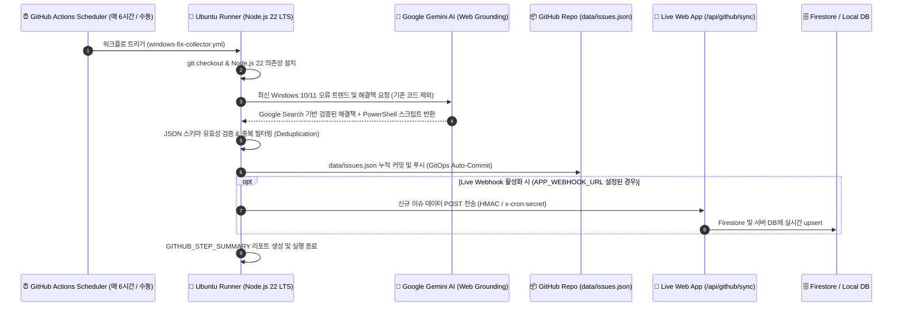

# GitHub Actions & GitOps 자율 데이터 수집 시스템 구축 가이드

본 문서는 **Windows Fix Wizard** 시스템에서 **GitHub Actions의 무료 클라우드 크론 러너(Free Cloud Runner)**와 **Google Gemini AI (Google Search Grounding)**를 결합하여, **서버 부하 및 상시 서버 과금(0원 운영)** 없이 최신 Windows 10/11 오류 트렌드와 검증된 해결책을 24/7 자율 수집하고 Git 저장소에 영구 버전 관리(GitOps)하는 전 과정 구축 및 운영 매뉴얼입니다.

---

## 📌 목차 (Table of Contents)
1. [아키텍처 및 핵심 메커니즘](#1-아키텍처-및-핵심-메커니즘)
2. [전체 데이터 라이프사이클 흐름도](#2-전체-데이터-라이프사이클-흐름도)
3. [프로덕션 워크플로 정밀 해설 (.github/workflows/windows-fix-collector.yml)](#3-프로덕션-워크플로-정밀-해설)
4. [GitHub 저장소 Secrets 및 권한(Permissions) 설정 필수 가이드](#4-github-저장소-secrets-및-권한permissions-설정-필수-가이드)
5. [Gemini AI 실시간 웹 그라운딩 수집 엔진 (scripts/github-collector.ts)](#5-gemini-ai-실시간-웹-그라운딩-수집-엔진)
6. [로컬 환경 및 터미널(CLI) 테스트 가이드](#6-로컬-환경-및-터미널cli-테스트-가이드)
7. [앱 관리자(Admin) UI 연동 및 원격 제어 매뉴얼](#7-앱-관리자admin-ui-연동-및-원격-제어-매뉴얼)
8. [GitOps 데이터셋 스키마 사양서](#8-gitops-데이터셋-스키마-사양서)
9. [실전 트러블슈팅 및 장애 조치 (FAQ)](#9-실전-트러블슈팅-및-장애-조치-faq)

---

## 🏗️ 1. 아키텍처 및 핵심 메커니즘

### 💡 왜 GitHub Actions 기반 GitOps인가?
일반적인 데이터 수집 시스템은 AWS EC2, GCP Compute Engine 등의 상시 가동 서버나 크론 데몬을 유지해야 하므로 매달 서버 비용이 발생하고, 서버 장애 시 수집이 중단됩니다.
반면 **Windows Fix Wizard의 GitOps 자율 수집 엔진**은 다음과 같은 혁신적 이점을 제공합니다:

1. **완전 무료 클라우드 인프라 (Zero-Cost Operation)**:
   - GitHub Actions는 퍼블릭 저장소에 대해 **무제한 무료 실행 시간**을 제공합니다.
   - 개인/프라이빗 저장소도 매월 2,000분(Ubuntu 기준 약 2,000회 실행)의 무료 쿼터를 제공하여 비용이 0원입니다.
2. **불변 데이터 이력 관리 (Immutable Git History)**:
   - 수집된 모든 문제는 `data/issues.json`에 `git commit`되어 커밋 단위로 이력이 보존됩니다.
   - 문제 발생 시 언제든지 특정 커밋으로 데이터를 롤백(Rollback)하거나 브랜치별로 격리 검증할 수 있습니다.
3. **무제한 글로벌 CDN 배포**:
   - Git 저장소에 커밋된 파일은 GitHub Raw Content CDN(`raw.githubusercontent.com`) 또는 GitHub Pages(`*.github.io`)를 통해 전 세계 어디서든 지연 없이 직접 읽어올 수 있습니다.
4. **듀얼 스토리지 자동 동기화 (Dual Storage Sync)**:
   - 파일(Git)과 클라우드 DB(Firestore) 양쪽에 병렬 저장되므로 한쪽 서비스가 일시 중단되어도 서비스 무중단이 유지됩니다.

---

## 🔄 2. 전체 데이터 라이프사이클 흐름도



---

## 📜 3. 프로덕션 워크플로 정밀 해설

`.github/workflows/windows-fix-collector.yml` 워크플로는 최신 GitHub Actions 표준(Node 22 LTS, Actions Checkout v4, Setup-Node v4)을 준수하도록 설계되어 있습니다.

```yaml
name: Windows Fix Autonomous Collector & GitOps Sync

on:
  # 1. 자동 스케줄링 (매 6시간마다 정기 실행)
  schedule:
    - cron: '0 */6 * * *'

  # 2. GitHub 웹 UI, 앱 관리자 센터, 또는 REST API를 통한 수동 실행
  workflow_dispatch:
    inputs:
      topic:
        description: '수집 대상 카테고리 (Target Error Category)'
        required: false
        default: 'all'
        type: choice
        options:
          - 'all'
          - '업데이트'
          - '네트워크'
          - '시스템/블루스크린'
          - '스토어/앱'
          - '정품인증'
          - '보안/백신'
          - '오디오/사운드'
          - '디스플레이/그래픽'
      batch_size:
        description: '수집할 해결책 개수 (1-4개 권장)'
        required: false
        default: '2'

# 3. Git 커밋 및 푸시를 위한 필수 권한 부여
permissions:
  contents: write

jobs:
  collect-and-sync:
    runs-on: ubuntu-latest
    timeout-minutes: 15

    steps:
      - name: 📥 Check out repository code
        uses: actions/checkout@v4
        with:
          fetch-depth: 0
          token: ${{ secrets.GITHUB_TOKEN }}

      - name: ⚙️ Set up Node.js 22 (LTS)
        uses: actions/setup-node@v4
        with:
          node-version: 22
          cache: 'npm'

      - name: 📦 Install project dependencies
        run: |
          npm ci || npm install --no-audit --prefer-offline

      - name: 🤖 Run Autonomous Windows Fix Collector via Gemini AI
        id: run-collector
        env:
          GEMINI_API_KEY: ${{ secrets.GEMINI_API_KEY }}
          APP_WEBHOOK_URL: ${{ secrets.APP_WEBHOOK_URL }}
          CRON_SECRET: ${{ secrets.CRON_SECRET }}
          INPUT_TOPIC: ${{ github.event.inputs.topic || 'all' }}
          BATCH_SIZE: ${{ github.event.inputs.batch_size || '2' }}
        run: |
          npx tsx scripts/github-collector.ts

      - name: 🚀 Commit & Push updated issues dataset (GitOps)
        run: |
          git config --local user.email "github-actions[bot]@users.noreply.github.com"
          git config --local user.name "github-actions[bot]"
          
          # 수집된 데이터셋 변경 여부 체크
          if [ -n "$(git status --porcelain data/issues.json data/github-feed.json)" ]; then
            git add data/issues.json data/github-feed.json
            TIMESTAMP=$(date -u +'%Y-%m-%d %H:%M UTC')
            git commit -m "🤖 [GitOps] Autonomous AI Windows Fixes collected ($TIMESTAMP) [skip ci]"
            
            # 동시 커밋 충돌 방지를 위한 rebase 재시도 루프 (최대 3회)
            for i in {1..3}; do
              git pull --rebase origin ${{ github.ref_name }} || true
              git push origin HEAD:${{ github.ref_name }} && break || sleep 5
            done
            echo "✅ Successfully committed and pushed updated dataset to repository."
          else
            echo "ℹ️ No dataset changes to commit in this cycle."
          fi
```

### ⏰ Cron 스케줄 시간대(Timezone) 변환표
GitHub Actions의 스케줄 크론은 **UTC 기준**으로 동작합니다. 한국 표준시(KST, UTC+9)와의 매핑은 아래와 같습니다:

| UTC 설정값 | KST (한국 시간) | 주기 설명 |
| :--- | :--- | :--- |
| `0 */6 * * *` | **09:00, 15:00, 21:00, 03:00** | 6시간 간격 하루 4회 실행 (권장) |
| `0 */4 * * *` | **09:00, 13:00, 17:00, 21:00, 01:00, 05:00** | 4시간 간격 하루 6회 실행 |
| `0 0,12 * * *` | **09:00, 21:00** | 출근 및 퇴근 시간 하루 2회 집중 수집 |

> 💡 **참고**: GitHub Actions 무료 러너의 부하 상황에 따라 스케줄 실행은 지정 시간으로부터 수 분에서 최대 15분 정도의 지연이 발생할 수 있으며 이는 정상 동작입니다.

---

## 🔑 4. GitHub 저장소 Secrets 및 권한(Permissions) 설정 필수 가이드

GitHub Actions가 문제 없이 자동 커밋하고 AI API를 호출하려면 **저장소 권한**과 **Secrets**가 반드시 올바르게 구성되어 있어야 합니다.

### 4-1. 🚨 필수! Workflow 쓰기 권한 활성화 (가장 흔한 403 오류 해결책)
기본적으로 신규 GitHub 저장소는 Actions 봇에게 '읽기 전용(Read only)' 권한만 부여합니다. 이 설정을 변경하지 않으면 `git push` 시 `Permission to ... denied to github-actions[bot]` 에러가 발생합니다.

1. 저장소 상단 메뉴의 **`Settings`** 탭을 클릭합니다.
2. 좌측 사이드바에서 **`Actions`** > **`General`** 메뉴를 클릭합니다.
3. 페이지 하단의 **`Workflow permissions`** 섹션으로 스크롤합니다.
4. **`Read and write permissions`** 라디오 버튼을 선택합니다.
5. 바로 아래 **`Allow GitHub Actions to create and approve pull requests`** 체크박스를 활성화합니다.
6. 초록색 **`Save`** 버튼을 눌러 저장합니다.

---

### 4-2. 저장소 Secrets 등록 (`Settings > Secrets and variables > Actions`)
우측 상단의 **`New repository secret`** 버튼을 눌러 다음 값들을 등록합니다:

| Secret 이름 | 설명 | 필수 여부 | 예시 값 |
| :--- | :--- | :---: | :--- |
| **`GEMINI_API_KEY`** | Google AI Studio에서 발급받은 Gemini API 키 | **필수** | `AIzaSy...` |
| **`APP_WEBHOOK_URL`** | 운영 중인 Windows Fix Wizard 웹사이트 주소 | 선택 (실시간 앱 동기화용) | `https://ais-pre-...run.app` |
| **`CRON_SECRET`** | 웹훅 인증용 비밀 문자열 (앱 환경변수의 `CRON_SECRET`과 일치) | 선택 | 임의의 강력한 난수 문자열 |

> 🔒 **보안 안내**: GitHub Secrets에 등록된 값은 실행 로그에서 자동으로 `***`로 마스킹되며, 커밋이나 코드 외부로 노출되지 않습니다.

---

## 🧠 5. Gemini AI 실시간 웹 그라운딩 수집 엔진 (`scripts/github-collector.ts`)

자율 수집 엔진인 `scripts/github-collector.ts`는 안정적인 수집을 위해 다층 방어 기법을 적용하고 있습니다.

### 1) 다중 모델 자동 폴백 (Multi-Model Resilience)
Gemini 특정 모델의 일시적인 쿼터 소진이나 서비스 점검 시 다음 순서로 즉시 폴백하여 중단 없이 수집을 완수합니다:
1. `gemini-2.5-flash` (기본 초고속 추론)
2. `gemini-3.5-flash` (심층 검색 추론)
3. `gemini-3.1-flash-lite` (경량 모델 폴백)
4. `gemini-2.5-flash-lite` (최종 비상 폴백)

### 2) 실시간 웹 그라운딩 (Google Search Grounding)
`tools: [{ googleSearch: {} }]` 옵션을 활성화하여, 단순 사전 학습된 지식이 아니라 **Microsoft 공식 지원 문서(support.microsoft.com), Windows 11 24H2/23H2 최신 릴리즈 노트, TechNet 포럼**의 실시간 오류 해결책을 검색하고 반영합니다.

### 3) 스마트 중복 방지 알고리즘 (Zero-Duplication Engine)
- 기존 `data/issues.json`에 이미 존재하는 오류 코드(`avoidCodes`)와 최근 제목 목록(`avoidTitles`)을 추출하여 프롬프트의 회피 리스트로 전달합니다.
- AI가 응답한 후에도 코드와 제목의 정규화(공백 및 대소문자 제거) 비교를 통해 2차 필터링을 수행합니다.

### 4) 안전한 PowerShell 스크립트 검증
생성된 모든 PowerShell 명령어는 시스템을 파괴하는 위험 명령어(`Format-Volume`, `rm -rf`, 무분별한 파일 삭제 등)가 배제되며, 진단(`sfc`, `dism`, `netsh`, 서비스 재기동 등) 위주의 안전한 명령어로 표준화됩니다.

---

## 💻 6. 로컬 환경 및 터미널(CLI) 테스트 가이드

GitHub Actions에 올리기 전, 내 컴퓨터 터미널에서 즉시 수집기를 실행하여 동작을 확인할 수 있습니다.

### 1) 기본 전체 수집 실행 (npm script)
```bash
# 기본 수집 실행 (랜덤 카테고리 1개, 2개 해결책 수집)
npm run collect:github
```

### 2) Windows PowerShell 환경에서 특정 파라미터 지정 실행
```powershell
# 블루스크린(BSOD) 관련 3개 항목 수집
$env:INPUT_TOPIC="시스템/블루스크린"
$env:BATCH_SIZE="3"
npm run collect:github
```

### 3) Windows 명령 프롬프트(CMD) 환경
```cmd
set INPUT_TOPIC=업데이트
set BATCH_SIZE=2
npm run collect:github
```

### 4) Linux / macOS / Git Bash 환경
```bash
INPUT_TOPIC="네트워크" BATCH_SIZE=2 npm run collect:github
```

수집이 완료되면:
- `data/issues.json` 파일에 신규 해결책이 자동으로 추가됩니다.
- `data/github-feed.json` 파일에 수집 모델, 대상 카테고리, 시간 정보가 요약 기록됩니다.

---

## 🎛️ 7. 앱 관리자(Admin) UI 연동 및 원격 제어 매뉴얼

Windows Fix Wizard 웹 애플리케이션의 **관리자 대시보드 (Admin Dashboard)** > **`GitHub Actions & GitOps 자율 데이터 수집 센터`**에서 모든 기능을 브라우저 클릭만으로 원격 제어할 수 있습니다:

### 1) 원격 워크플로 가동 (Dispatch Workflow via API)
- GitHub 웹사이트에 로그인하지 않고도, 앱 화면에서 원하는 카테고리(`업데이트`, `블루스크린`, `네트워크` 등)를 선택하고 **`워크플로 가동`** 버튼을 누르면 GitHub REST API를 통해 클라우드 러너가 즉시 시작됩니다.
- *요구사항*: 저장소 접근 권한이 있는 Personal Access Token(PAT, `workflow` 또는 `repo` 권한)이 앱에 입력되어 있어야 합니다.

### 2) 지금 데이터 불러와 동기화 (Pull Data Now)
- GitHub Actions가 커밋해 둔 최신 `data/issues.json` 파일을 원클릭으로 가져옵니다.
- 브라우저나 로컬 서버에서 실행 중인 경우, AI API 호출 비용을 단 1원도 쓰지 않고 GitHub 저장소의 정제된 데이터를 즉시 앱 데이터베이스에 병합합니다.

### 3) GitHub Pages 정적 웹사이트와의 연동
- 본 앱이 GitHub Pages 정적 웹사이트(`https://AhBiYout-all.github.io/windows-fix-wizard/`)로 배포되어 있어도, 수집된 GitOps 데이터(`data/issues.json`)는 GitHub CDN을 통해 실시간으로 조회 가능합니다.

---

## 📋 8. GitOps 데이터셋 스키마 사양서

수집된 데이터는 `data/issues.json`에 아래와 같은 엄격한 TypeScript 인터페이스 구조로 정규화되어 저장됩니다:

```typescript
export interface KnownIssue {
  id: string;                     // 고유 식별자 (예: gh-0x80070005-m1a2b3)
  category: string;               // 카테고리 (업데이트, 시스템/블루스크린, 네트워크 등)
  code: string;                   // Windows 오류 코드 (예: 0x80070005, KERNEL_DATA_INPAGE_ERROR)
  title: string;                  // 한국어 제목
  title_en?: string;              // 영어 제목 (글로벌 지원)
  symptoms: string;               // 한국어 증상 상세
  symptoms_en?: string;           // 영어 증상 상세
  script?: string;                // 자동 해결용 안전한 PowerShell 스크립트
  manualSteps: string[];          // 한국어 단계별 수동 복구 가이드 (3~5단계)
  manualSteps_en?: string[];       // 영어 단계별 수동 복구 가이드
  sourceUrls: string[];           // 공인 기술 문서 링크 (support.microsoft.com 등)
  source?: string;                // 출처 표기 (GitHub Actions Autonomous Collector)
  windowsVersions?: string[];     // 적용 Windows 버전 (['Windows 11', 'Windows 10'])
  searchKeywords?: string[];      // 검색 키워드 목록
  upvoteCount?: number;           // 커뮤니티 추천수
  isLatest?: boolean;             // 최신 수집 여부 플래그 (true)
  createdAt?: string;             // 생성 일시 (ISO 8601)
  updatedAt?: string;             // 갱신 일시 (ISO 8601)
  verifiedAt?: string;            // 검증 일시 (ISO 8601)
  verificationStatus?: 'verified' | 'needs_update' | 'obsolete'; // AI 검증 상태
}
```

---

## ❓ 9. 실전 트러블슈팅 및 장애 조치 (FAQ)

### Q1. `git push` 단계에서 `Permission to ... denied to github-actions[bot]` (403) 오류가 발생합니다.
> **원인**: GitHub 저장소의 Actions 기본 권한이 'Read only'로 제한되어 있기 때문입니다.  
> **해결책**: 본 문서 [4-1 섹션](#4-1--필수-workflow-쓰기-권한-활성화-가장-흔한-403-오류-해결책)을 참조하여 저장소 `Settings` > `Actions` > `General` > `Workflow permissions`에서 **`Read and write permissions`**를 활성화하고 저장하세요.

### Q2. 워크플로 실행 시 `GEMINI_API_KEY is not configured` 에러가 발생합니다.
> **원인**: GitHub Secrets에 API 키가 등록되지 않았거나 이름 오타가 발생했습니다.  
> **해결책**: 저장소 `Settings` > `Secrets and variables` > `Actions`로 이동하여 시크릿 이름을 정확히 `GEMINI_API_KEY`로 생성하고 Google AI Studio의 API 키를 입력하세요.

### Q3. 여러 워크플로가 동시에 실행되거나 로컬에서 커밋을 올려서 충돌(Conflict)이 나면 어떻게 되나요?
> **해결책**: 워크플로의 푸시 스텝에 `git pull --rebase origin ${{ github.ref_name }}` 재시도 루프가 3회 구현되어 있어, 최신 원격 변경사항을 자동으로 리베이스한 뒤 푸시하므로 충돌로 인한 워크플로 실패가 방지됩니다.

### Q4. 스케줄 크론(`0 */6 * * *`)이 정각에 바로 돌지 않습니다.
> **설명**: GitHub Actions의 스케줄 큐는 무료 공유 풀을 사용하므로 서버 부하에 따라 5분~15분 정도의 지연이 발생할 수 있습니다. 정상 동작이며 지연 후 반드시 실행됩니다. 즉시 수집을 원할 경우 Actions 탭의 **`Run workflow`** 버튼이나 앱 UI의 **`워크플로 가동`** 버튼을 누르시면 됩니다.

### Q5. 수집 결과를 한눈에 확인하려면 어디로 가야 하나요?
> **확인 방법**:
> 1. GitHub 저장소의 **`Actions`** 탭을 클릭합니다.
> 2. 가장 최근 실행된 **`Windows Fix Autonomous Collector & GitOps Sync`** 실행 건을 클릭합니다.
> 3. 실행 결과 페이지 하단의 **`Summary` (Step Summary)** 섹션에 AI 모델, 수집된 오류 코드, 해결책 목록이 표(Table) 형태로 예쁘게 정리되어 표시됩니다.
